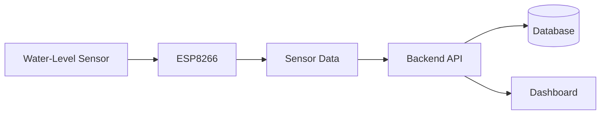
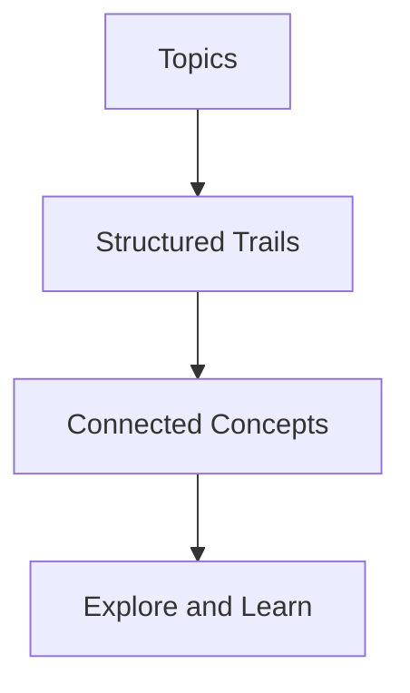
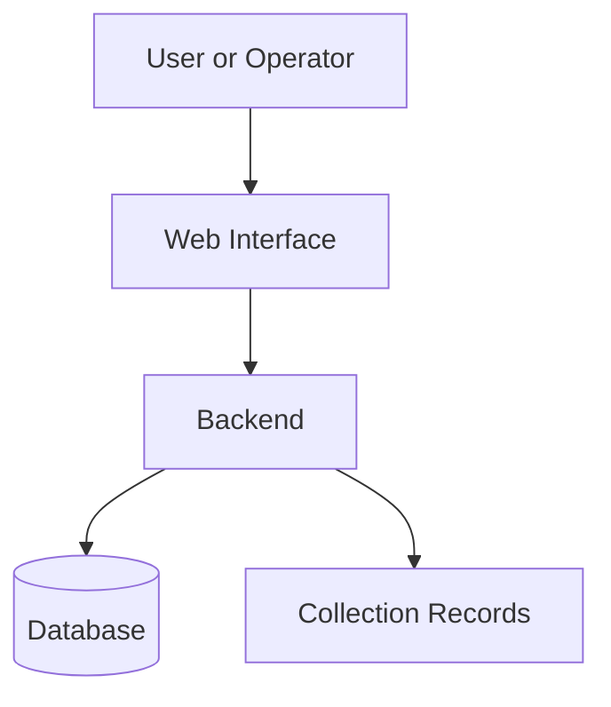

<!-- ===================== ANIMATED HEADER ===================== -->

 

  

  

---

## `01` — A little about me

Hey, I'm **Rian**, a B.Tech Computer Science student specializing in **Artificial Intelligence and Machine Learning at Lovely Professional University**.

I'm interested in building software, understanding how systems work, and exploring how AI can be used to solve real problems.

Most of my learning happens through projects. I experiment, make mistakes, debug things, and try to understand the reasoning behind what I'm building.

- 💻 Programming and software development
- 🌐 Web applications and backend systems
- 🤖 Artificial intelligence and machine learning
- 🔧 APIs, databases, and system design
- 🚀 Personal projects and collaborative development

---

## `02` — Projects

### 🌊 VirtualEdge

An IoT-based flood-monitoring project that combines water-level sensor readings with a backend for receiving, storing, and monitoring data.

**My focus:** Backend APIs, sensor-data processing, and dashboard integration.

**Technologies:** Python, FastAPI, ESP8266, and web technologies.

### 🌐 Infotris

A platform built around organizing knowledge into structured trails, helping people explore topics and discover how concepts connect.

**Focus:** Knowledge organization, learning paths, and educational technology.

### ♻️ ReCircuit

A smart e-waste management website concept focused on organizing collection records, waste tracking, and operational workflows.

**Exploring:** Django, databases, user workflows, and location-based features.

### 🤖 Sidekick

A long-term idea for a personal assistant that connects AI with notes, tasks, reminders, and supported application actions.

The concept emphasizes user permissions, understandable actions, and control over automation.

---

## `03` — Technologies

  

  

These represent technologies I've used or explored in my development journey. My experience varies by technology.

---

## `04` — Current learning

| Area | Current focus |
|:--|:--|
| Python & C++ | Fundamentals and problem-solving |
| DSA | Data structures and algorithms |
| Web development | HTML, CSS, JavaScript |
| Backend | APIs, databases, application structure |
| AI & ML | Mathematics and core concepts |
| Engineering | Debugging, testing, and documentation |

- [ ] Strengthen programming fundamentals
- [ ] Improve problem-solving and DSA
- [ ] Build complete web applications
- [ ] Understand database design and APIs
- [ ] Develop practical AI/ML projects
- [ ] Contribute to open-source projects

---

## `05` — GitHub activity

  

---

## `06` — Contribution journey

---

## `07` — Let's connect

  

<!-- Add verified LinkedIn and email links when ready. -->

  

**BUILD • LEARN • IMPROVE**

