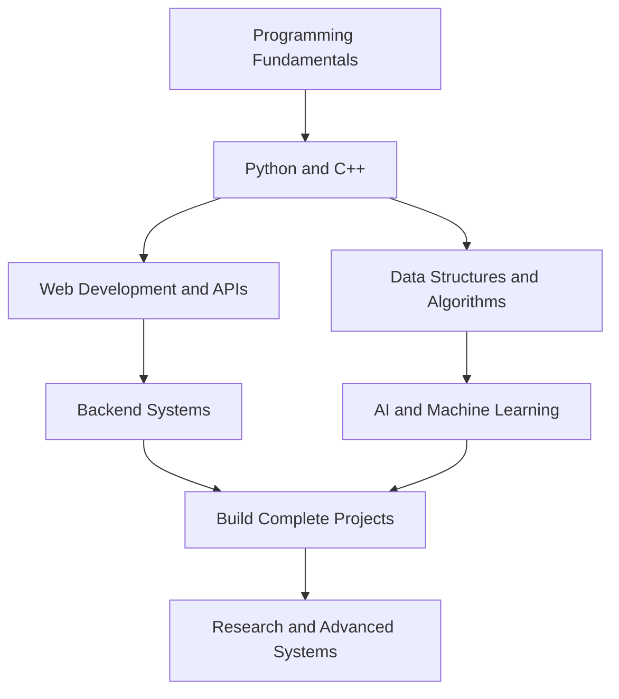

<!-- ===================== HEADER ===================== -->

  

  

 

<!-- ===================== ABOUT ===================== -->
## 👋 About Me

Hey, I'm **Rian**, a B.Tech CSE student specializing in **Artificial Intelligence and Machine Learning at Lovely Professional University**.

I'm interested in software development, AI, and building things that solve actual problems. Most of my learning happens while working on projects, figuring things out, and improving what I've already built.

- 🎓 B.Tech CSE — AI & ML
- 💻 Learning programming and software engineering
- 🌐 Building web applications and backend systems
- 🤖 Exploring AI, machine learning, and intelligent applications
- 🔧 Interested in turning ideas into working projects

I don't know everything yet, and that's fine. I'm here to learn, build, and get better.

 

<!-- ===================== TECH STACK ===================== -->
## 🧰 Tech Stack

### 💻 Programming & Web Development

  

### ⚙️ Backend & Databases

  

### 🛠️ Tools & Platforms

  

### 🤖 Areas I'm Exploring

  
  
  
  

 

<!-- ===================== PROJECTS ===================== -->
## 🚀 Projects

### 🌐 [Infotris](https://infotris.com)

**A structured way to explore knowledge and learning paths.**

I'm working on a platform that organizes knowledge into structured trails, helping people explore topics and understand how different concepts connect.

- **Focus:** Learning paths, knowledge organization, and educational technology
- **Exploring:** Better learning experiences and structured content

### 🌊 [VirtualEdge](https://github.com/suryansh-cse/VirtualEdge)

**IoT-based flood monitoring and alert system.**

A collaborative project focused on monitoring water levels using sensor data and sending that data to a backend for monitoring.

- **Focus:** ESP8266, sensor data, backend APIs, and dashboards
- **Technologies:** Python, FastAPI, IoT, and web technologies

### ♻️ ReCircuit

**Smart e-waste management system.**

A web application concept focused on making electronic waste collection and tracking more organized.

- **Focus:** E-waste collection, tracking, and management
- **Exploring:** Web development, databases, and location-based features

### 🤖 Sidekick

**A personal AI assistant concept.**

A long-term idea for an assistant that connects AI with everyday applications, notes, tasks, and workflows, with user-controlled permissions.

- **Focus:** AI assistants, automation, and application integration
- **Status:** Concept and future development

 

<!-- ===================== ROADMAP ===================== -->
## 🗺️ Learning Roadmap

My goal is to develop strong programming fundamentals first, then use them to build more capable software and AI-powered systems.

 

<!-- ===================== CURRENT FOCUS ===================== -->
## 🎯 What I'm Focusing On

| Area | Current direction |
|:--|:--|
| 🐍 Python | Programming fundamentals and applications |
| 💻 C++ | Problem-solving and core programming |
| 🌐 Web Development | HTML, CSS, JavaScript, and backend development |
| 🗄️ Databases | SQL, data modeling, and application storage |
| 🤖 AI & ML | Mathematics, fundamentals, and practical projects |
| 🔧 Git & GitHub | Version control and collaborative development |
| 🚀 Projects | Building, testing, debugging, and improving applications |

 

<!-- ===================== LEARNING ===================== -->
## 🌱 Currently Learning

- [ ] Strengthen Python and C++ fundamentals
- [ ] Improve problem-solving and DSA
- [ ] Build better backend applications and APIs
- [ ] Get more comfortable with databases
- [ ] Learn the mathematics behind machine learning
- [ ] Build practical AI/ML projects
- [ ] Contribute to open-source projects
- [ ] Learn by building and shipping projects

 

<!-- ===================== GITHUB STATS ===================== -->
## 📊 GitHub Stats

  

 

<!-- ===================== CONTRIBUTIONS ===================== -->
## 🐍 Contribution Graph

 

<!-- ===================== CONNECT ===================== -->

 

## 🤝 Find Me Online

&nbsp;

  

If you're working on something interesting, feel free to check out my repositories.

 

**BUILD • LEARN • IMPROVE**

 

Thanks for stopping by!

