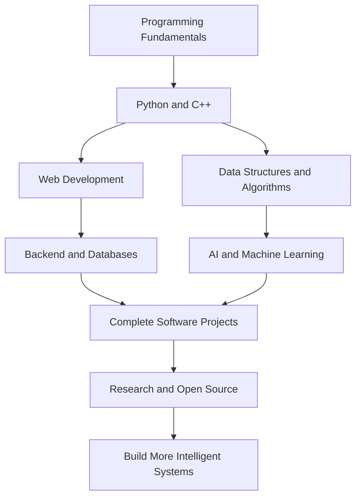

 

---

## About

Hey, I'm **Suryansh**, a Computer Science student specializing in **Artificial Intelligence and Machine Learning at Lovely Professional University**.

I enjoy taking an idea, figuring out how it could work, and turning it into something people can actually use.

Right now, I'm building my foundation in programming, web development, backend systems, and AI/ML through coursework and personal projects.

I'm particularly interested in the intersection of **software engineering and intelligent systems** — not just using technology, but understanding how it works and what I can build with it.

- 🎓 B.Tech CSE — AI & ML
- 💻 Learning by building and experimenting
- 🌐 Interested in full-stack development and backend engineering
- 🤖 Exploring machine learning and AI-powered applications
- 🔬 Interested in research, open source, and collaborative projects

I believe the best way to learn is to build something, break it, understand why, and make it better.

## Selected Projects

### 🌊 VirtualEdge — Flood Monitoring

An IoT-based flood monitoring project that combines water-level sensing with software for data collection and monitoring.

- **Working on:** Sensor data pipelines, backend APIs, and dashboard integration
- **Technologies:** Python, FastAPI, ESP8266, and web technologies
- **Goal:** Turn sensor readings into useful monitoring information

[View repository →](https://github.com/suryansh-cse/VirtualEdge)

### 🌐 Infotris — Knowledge & Learning

A platform built around the idea of organizing knowledge into structured trails, making it easier to explore subjects and understand how concepts connect.

- **Focus:** Knowledge organization and learning experiences
- **Exploring:** Structured learning paths and educational technology

[Visit Infotris →](https://infotris.com)

### ♻️ ReCircuit — E-Waste Management

A web application project focused on making electronic waste collection and tracking more organized.

- **Focus:** Collection workflows, data management, and tracking
- **Exploring:** Backend development, databases, and location-based features

### 🤖 Sidekick — Personal AI Assistant

A long-term project idea exploring how AI could connect with everyday applications, personal notes, tasks, and workflows.

- **Focus:** AI-assisted workflows, automation, and application integration
- **Status:** Long-term concept and exploration

---

## Technologies

### Languages & Web

### Backend & Data

### Development Tools

> These are technologies from my current development and learning journey, not a claim of equal proficiency in every tool.

## What I'm Working On

| Area | Focus |
|:--|:--|
| Programming | Strengthening Python and C++ fundamentals |
| Problem-solving | Developing logical thinking and DSA skills |
| Web development | Improving frontend and backend skills |
| Backend engineering | APIs, databases, and application architecture |
| AI & ML | Learning the fundamentals before moving to advanced projects |
| Projects | Building, testing, debugging, and documenting real applications |

## Learning Roadmap

The plan is simple: develop strong fundamentals, build increasingly complex projects, and learn the theory behind the systems I create.

## GitHub Activity

  

GitHub statistics are automatically generated and may occasionally be unavailable. Language statistics reflect repository code, not necessarily proficiency.

---

## Beyond the Code

I'm interested in more than completing assignments. I want to understand how software systems are designed, how AI can solve useful problems, and how small projects can eventually grow into something more capable.

For now, that means staying curious, learning the fundamentals, and doing the work.

### Build. Learn. Improve. Repeat.

Thanks for visiting my profile.

